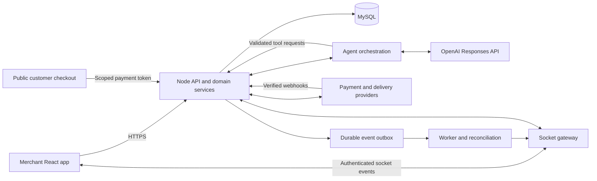

# Safer Business — implementation plan

Status: frontend milestone implemented, 17 October 2026. React application and mock API flows are in `apps/web`; shared contracts are in `packages/contracts`. Backend and live integrations remain pending. See `docs/FRONTEND_HANDOFF.md` and `docs/QA_REPORT.md`.

## 1. Product scope and source of truth

Safer Business is a merchant-only business management application with an AI conversation at its centre. Merchants manage payment links, balances, private inventory and deliveries through chat and conventional screens.

Use the latest approved desktop and mobile designs in [Figma](https://www.figma.com/design/qd7RjWOQwVGlmcjt7pjFbp/Draft). Local design exports and ledgers help locate screens, but several older documents contain superseded requirements. In particular, `designs/README.md`, `designs/figma-handoff.md` and some screen inventories still mention buyer accounts, green marketplace styling or Stellar wallet connection. Those requirements must not enter the implementation.

Current scope:

- Landing page with the latest user-edited section colours and African business photography.
- Merchant onboarding: email or phone number, OTP verification, password and business details; login and password recovery.
- Agent workspace: recent payments on the left, conversation in the centre, business tools and USD/NGN balances on the right. Responsive mobile equivalents follow the designs.
- Payment links in USD or NGN, generated-link details, payment history and receipts.
- Foreign USD checkout with US virtual account or USDC receiving-address options, subject to provider support. NGN checkout uses the selected local payment provider.
- Private catalogue showing items sold and remaining, with stock recording and correction flows.
- Delivery request, quote/review, booking and tracking.
- Merchant profile, settings and withdrawal review.
- Public customer checkout and payment status pages without customer accounts.

Excluded: buyer registration, public product marketplace, shopping cart and Stellar wallet connection.

Preserve Kanit for major typography, the supplied B logo, approved copy and the latest Figma colours. Tagline: “An agentic merchant system built for your success.” Supporting copy: “Manage payments, track stock, and coordinate deliveries—all with AI by your side.”

Frontend recent-payment rows now use receipt icons. The earlier icon cleanup in the Figma source remains unverified; no claim is made that the source file was changed during this build.

## 2. Recommended technology choices

| Layer | Recommendation | Purpose |
| --- | --- | --- |
| Frontend | React + TypeScript + Vite | Responsive merchant application with typed feature modules |
| Routing | React Router | Public, onboarding and authenticated route layouts |
| Styling | CSS variables and CSS Modules | Exact Figma tokens and maintainable component styling |
| Remote state | TanStack Query | API caching, pagination, loading/error states and invalidation |
| Forms | React Hook Form + Zod | Accessible form handling and shared validation schemas |
| Backend | Node.js + TypeScript + Fastify | Modular API with explicit schemas and domain services |
| Database | MySQL + Prisma migrations | Durable business records and transactional operations |
| Live communication | Socket.IO over WebSocket | Chat streaming, action progress and payment/delivery updates |
| AI | Server-side OpenAI Responses API + function tools | Conversation and controlled business actions |
| Verification | Vitest, React Testing Library, Playwright | Domain checks, interaction tests and complete journeys |

Keep the backend a modular monolith initially: auth, payments, catalogue, deliveries and agent orchestration share a deployable service with clear module boundaries. Add a worker process for retries and reconciliation when real providers are integrated. Introduce Redis only when multi-instance sockets or queue requirements justify it.

Vite is suitable for the authenticated merchant SPA. The public landing page needs a separate SEO decision during setup: prerender it or use React Router's server-rendering facilities if organic search is a launch priority. Do not leave this decision until deployment. React's documentation describes the routing, data-fetching and rendering responsibilities of a custom Vite setup: [React guidance](https://react.dev/learn/build-a-react-app-from-scratch).

Socket.IO is a library using WebSocket and potentially fallback transports; its protocol is not interchangeable with a raw WebSocket client. If native WebSocket compatibility is a requirement, use `ws` and implement the same acknowledgement/recovery contract explicitly.

Pin compatible supported dependency versions and Node LTS at scaffolding time, commit a lockfile and document environment variables. No model name is hardcoded into frontend code; choose and configure the model after task-specific quality, latency and cost evaluation.

## 3. System boundaries



The browser never receives OpenAI or payment-provider secrets. The server authenticates each request, derives the merchant business scope and validates every action. MySQL and verified provider events determine payment status and balances. AI text is never evidence that money arrived.

HTTP handles initial data, queries and durable commands. Sockets distribute live conversation and business events. All critical state remains recoverable through HTTP after a disconnect.

## 4. Frontend structure and routes

Start with a small workspace; create backend folders when backend implementation begins:

```text
apps/
  web/
    src/
      app/                 # router, providers, route layouts
      components/ui/       # buttons, inputs, dialogs, feedback
      components/layout/   # merchant shell, recent payments, business panel
      features/
        landing/
        auth/
        agent/
        payments/
        catalogue/
        deliveries/
        profile/
        settings/
      lib/                 # HTTP client, socket adapter, money/date formatters
      mocks/               # MSW handlers, fixtures and simulated events
      styles/              # tokens, fonts and global styles
  api/                     # added in backend phase
packages/
  contracts/               # Zod schemas, DTOs, event types and errors
docs/                      # architecture and integration decisions
```

Each page lives in an independent route module, with shared components reused across pages. Desktop and mobile use responsive layouts over the same business state rather than separate application implementations.

| Route | Screen/flow |
| --- | --- |
| `/` | Landing page |
| `/signup`, `/signup/verify`, `/signup/password`, `/signup/business` | Onboarding |
| `/login`, `/password/reset` | Sign-in and recovery |
| `/app` | Agent workspace |
| `/app/payments`, `/app/payments/:id` | Payments, balances and receipt/details |
| `/app/payment-links`, `/app/payment-links/:id` | Links, creation and generated-link details |
| `/app/catalogue` | Private inventory and stock actions |
| `/app/deliveries`, `/app/deliveries/:id` | Booking, history and tracking |
| `/app/profile`, `/app/settings` | Merchant account and preferences |
| `/pay/:token` | Public checkout, pending, failure and receipt states |

Protect private routes, preserve the intended destination after login and handle expired sessions. Client route guards improve experience; server authorization supplies actual access control.

## 5. Phased delivery and acceptance criteria

### Phase 0 — design handoff and contracts

1. Inventory current Figma desktop/mobile screens and map them to routes and reusable components.
2. Extract authoritative typography, colours, spacing, borders, radii, assets and responsive behaviours. Record node references and reference screenshots.
3. Verify receipt icons in Recent payments; identify any missing pending/error/empty states and implement them consistently with the established design.
4. Create API DTOs, event envelopes, money types, domain statuses and sample fixtures before building feature screens.
5. Verify image licences/credits, export the supplied logo and use appropriately sized local assets.

Acceptance: a screen checklist, token definitions, asset manifest and typed contract baseline. The Figma connector has reached its current quota; high-fidelity context extraction is a dependency for implementation and must be restored or supplied through usable design exports. Existing screenshots are useful references but cannot replace missing layout specifications.

### Phase 1 — frontend foundation and responsive shell

Set up React/TypeScript, routing, token styles, fonts, linting, type checking, a production build and fixture-backed API adapters. Build shared primitives and the merchant shell, including Recent payments and the USD/NGN business panel. Implement the approved landing page and onboarding views.

Acceptance: public/private layouts render at mobile, tablet and desktop sizes; forms support keyboard navigation, validation and recoverable errors; the application can build and run from documented commands. OTP and sessions are clearly simulated in development, not represented as production authentication.

### Phase 2 — first complete merchant journey

Implement: signup → verification → password/business setup → workspace → “Create a payment link for $120” → missing-information prompts → review → generated link → public checkout → pending/payment-success receipt → updated recent-payment list.

Repeat for NGN. USD checkout demonstrates both US virtual-account and USDC options using fixture data. Include copying/sharing a link, invalid/expired links, payment failure and retry.

Chat renders typed business cards: payment drafts, confirmation requests, generated links, stock summaries, delivery quotes and receipts. Provide normal form-driven access to the same operations so a merchant can complete a task when AI is unavailable.

Acceptance: the entire journey works with mock APIs and simulated events, survives a page reload where appropriate and has meaningful end-to-end coverage. All demonstration funds/accounts are identified as test data. This milestone is an integrated frontend prototype, not live payment processing.

### Phase 3 — remaining frontend features

Complete private inventory, sold/remaining summaries, stock recording, payment filters/details, balances, withdrawal review, delivery quote/booking/tracking, profile and settings. Add loading, empty, permission-denied, offline, unavailable-provider and expired-session states. Add interrupted response, cancellation and reconnect handling to chat.

Acceptance: every approved current design screen has an implemented route or interaction; no dead primary buttons; responsive screenshot comparisons are reviewed against Figma. Stock and payment states are coherent across chat, details and side panels.

### Phase 4 — Node/MySQL services and provider integration

Build real OTP/session authentication, merchant isolation and server validation. Implement payments, links, transactional ledger, stock movements and delivery adapters. Integrate selected providers in sandbox mode, verified webhooks, idempotency and reconciliation. Replace frontend mock adapters feature by feature without rewriting UI components.

Acceptance: real sandbox onboarding/payment/delivery journeys work; cross-merchant access is rejected; duplicate or reordered provider events cannot double-credit a balance; concurrent stock operations do not oversell; pending and failed operations remain recoverable.

### Phase 5 — live agent and reliable communication

Connect the server-side OpenAI Responses API. Expose narrowly scoped function tools for balances, payment history, stock queries, link preparation and delivery preparation. Add persisted chat, run status, acknowledgements, reconnect recovery and durable domain events.

Acceptance: AI uses real authorized tool results, asks for required information and never invents successful business operations. Retries do not duplicate actions. Business operation recovery works if a model response, socket connection or provider request fails.

### Phase 6 — production release readiness

Complete staging deployment, observability, backups/restore verification, accessibility review, performance checks and production provider configuration. Run critical journeys and failure scenarios before enabling live money movement.

Acceptance: CI passes lint/type/build and relevant tests; no browser secrets; no unresolved critical access-control/payment issues; production runbooks and rollback procedures exist; selected providers and receiving-account eligibility have been confirmed.

## 6. Contracts to establish during frontend work

### Money and balances

Represent monetary amounts as integer strings with explicit asset and scale, for example `{ asset: 'NGN', amountMinor: '8500000', scale: 2 }` for ₦85,000. USD/NGN use two decimal places; USDC units use their rail/provider-defined precision, typically six. Avoid JavaScript floating-point arithmetic for money. Use exact integer/decimal operations on the server.

A USD-denominated payment link and a USDC settlement are separate concepts. Preserve invoice currency, settlement asset, exchange rate, fees and resulting ledger entries. Do not silently treat USDC holdings as identical to USD cash. The USD balance display policy is an explicit product/provider decision.

### HTTP contract outline

- Auth: signup challenges, OTP verification, password setup, sessions and recovery.
- Workspace bootstrap: merchant profile, available/pending balances and recent payments.
- Payments: link drafts, confirmation/execution, generated link details, list/detail queries and withdrawal drafts.
- Inventory: items, summaries and atomic stock movements.
- Deliveries: quote, booking confirmation and tracking queries.
- Agent: conversation history, message submission, run cancellation and approved action submission.
- Public checkout: scoped link details, allowed methods and verified payment status.

Specify validation, pagination, idempotency keys and stable error codes. Retryable failures must differ from rejected or completed actions.

### Socket contract outline

Event envelope: `{ eventId, type, businessId, entityId, version, occurredAt, payload }`. Chat chunks also carry run/message IDs and a sequence number. Clients submit a stable `clientMessageId`; the server acknowledges after persistence and deduplicates retries.

Events include `message.accepted`, `agent.run.started`, `agent.text.delta`, `agent.action.ready`, `agent.run.completed`, `agent.run.failed`, `payment.updated`, `balance.updated`, `inventory.updated` and `delivery.updated`.

Authenticate connections and authorize every subscription. Persist business events with an outbox, resume from a cursor after reconnect and refetch authoritative state when the cursor has expired. Token deltas can be transient; persist final messages and run outcomes for recovery. Discard stale entity versions and deduplicate event IDs.

Socket.IO's default delivery is at-most-once, so reconnection alone does not guarantee missed updates are recovered. This is why the application needs persistence and replay: [Socket.IO delivery guarantees](https://socket.io/docs/v4/delivery-guarantees/).

## 7. Agent execution rules

Use OpenAI function calling to connect the model to application services, as described in the [official function-calling guide](https://developers.openai.com/api/docs/guides/function-calling). The server owns the tool execution loop and relays response progress to the frontend. OpenAI's upstream streaming transport need not match the browser socket transport.

Read tools can fetch authorized stock, payments and balance data. Write tools prepare immutable action drafts. The merchant reviews relevant amount/currency, recipient, stock impact, delivery details and fees before execution. The server revalidates permissions and current state on confirmation, ties approval to the exact draft version and executes with an idempotency key. Expired or changed drafts require a fresh review.

Never let the model run arbitrary SQL or accept a business ID as proof of authorization. Validate arguments against strict schemas and derive access scope from the authenticated session. Treat messages, catalogue text and tool output as untrusted content. Keep secrets and unnecessary personal data out of prompts and logs.

Bound tool-call count, runtime and token usage. Support cancellation and explicit failure states. A provider timeout means unknown/pending until reconciliation resolves it; it does not mean safe-to-repeat without idempotency. Evaluate currency interpretation, ambiguous instructions, unauthorized data requests, prompt injection, retries and confirmation bypass attempts before launch.

## 8. Backend data model direction

| Domain | Core records |
| --- | --- |
| Identity | Merchant users, businesses, sessions, verification challenges |
| Payments | Payment links, payment attempts, provider references, webhook events |
| Accounting | Ledger accounts, transactions and balanced entries per asset |
| Catalogue | Items, stock movements and payment/sale references |
| Delivery | Quotes, bookings, tracking events and provider references |
| Agent | Conversations, messages, runs, action drafts and approvals |
| Operations | Audit records, outbox events and reconciliation jobs |

Use database transactions and uniqueness constraints for financial and inventory invariants. Store available/pending balance semantics explicitly. Define when a sale decrements stock and how cancellations/refunds restore it; manual sale recording and payment-driven updates must reference the same sale to avoid duplicate deductions.

## 9. Quality and release gates

- Visual: compare implemented screens at the design reference sizes and intermediate widths; preserve the latest user colour edits, Kanit headings, logo and nonduplicated African photography.
- Interaction: complete keyboard journeys, focus management, labels, useful validation, responsive dialogs and a WCAG 2.2 AA accessibility target.
- Functional: cover onboarding, both payment currencies, generated links, checkout status, stock movement and delivery request.
- Recovery: test refresh, duplicate submissions, socket disconnect, failed model runs and provider timeouts.
- Security: secure HttpOnly sessions, CSRF protections appropriate to cookie auth, origin validation on sockets, rate-limited OTP attempts, expiry, hashed passwords, server authorization and redacted logs. Do not store session credentials in localStorage.
- Performance: lazy-load route features, optimize images/fonts, measure layout stability and initial load on a representative mobile network; agree measurable budgets at baseline.
- Backend correctness: test tenant isolation, money precision, ledger balancing, webhook deduplication, inventory concurrency and action approval binding.
- Operations: health checks, request/run correlation IDs, error monitoring, alerts for reconciliation failures, tested migrations and rollback/restore instructions.

## 10. Decisions required before live integrations

These do not block fixture-based frontend work:

1. Payment providers for NGN, USD virtual accounts and USDC; supported countries, rails, settlement/fee rules and receiving-account eligibility.
2. Meaning of USD balance when payments settle through different assets; conversion, available/pending and withdrawal policies.
3. Delivery provider and service areas, quotation expiry, cancellation and booking rules.
4. Email/SMS OTP service and account recovery policy. Email/phone onboarding is the baseline; earlier Google signup is optional scope until reconfirmed.
5. Production hosting and whether landing-page SEO requires prerendering/server rendering.

First implementation deliverable: the token/component foundation, responsive merchant shell and onboarding, followed by the complete payment-link journey. Backend contracts are defined alongside that work; production integrations follow after the frontend behaviours are validated.
